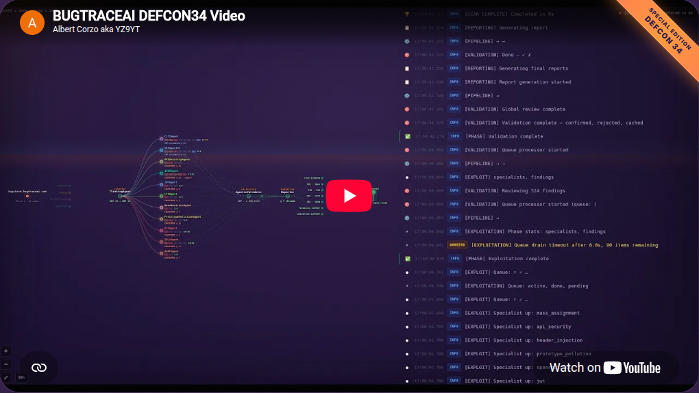
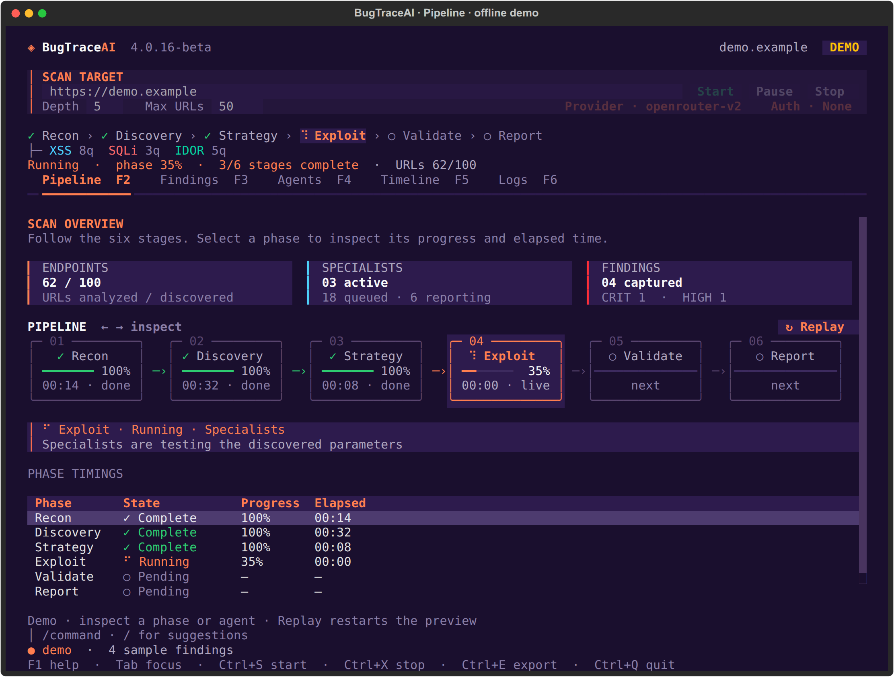
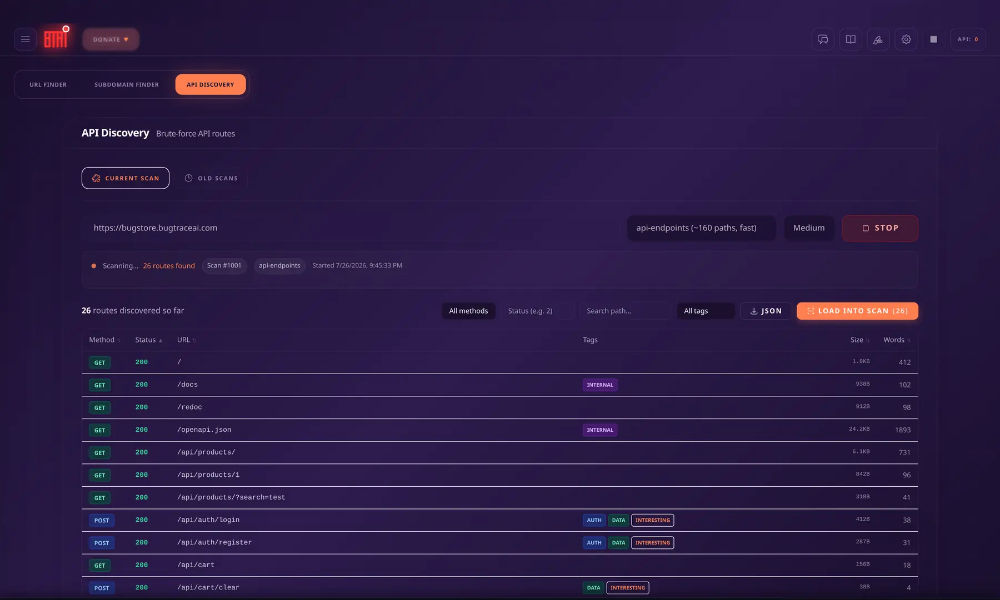
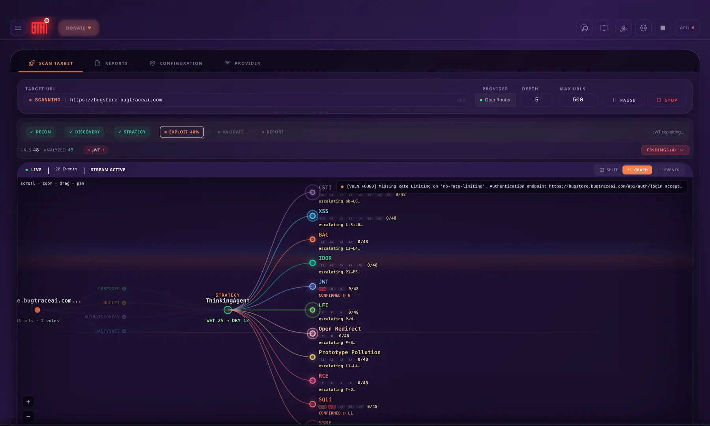
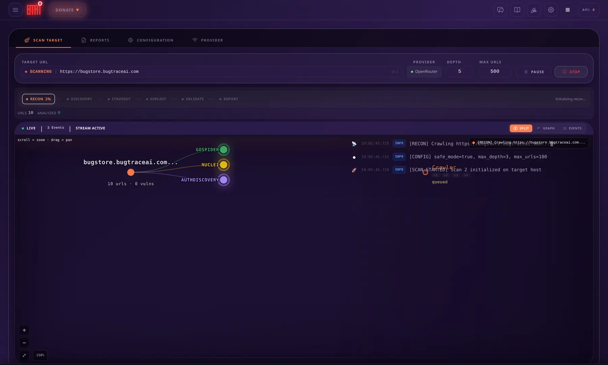
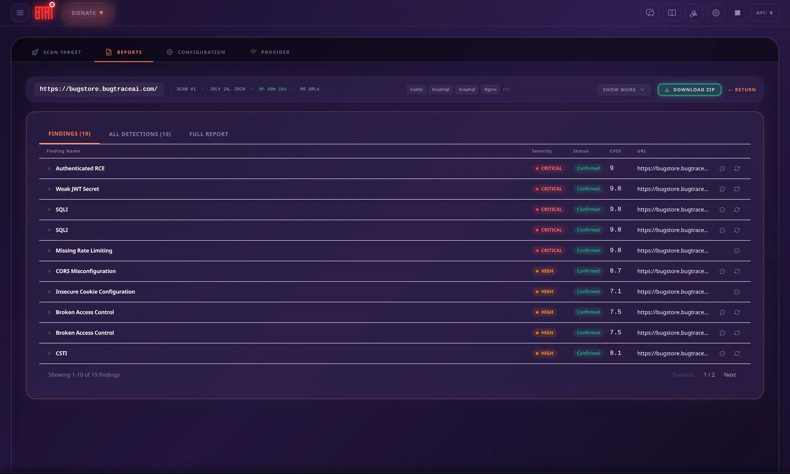
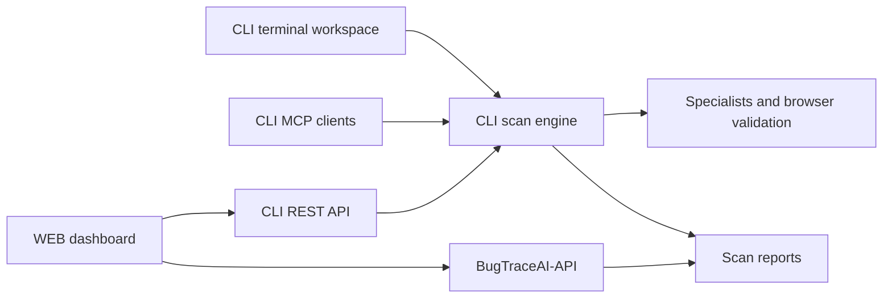
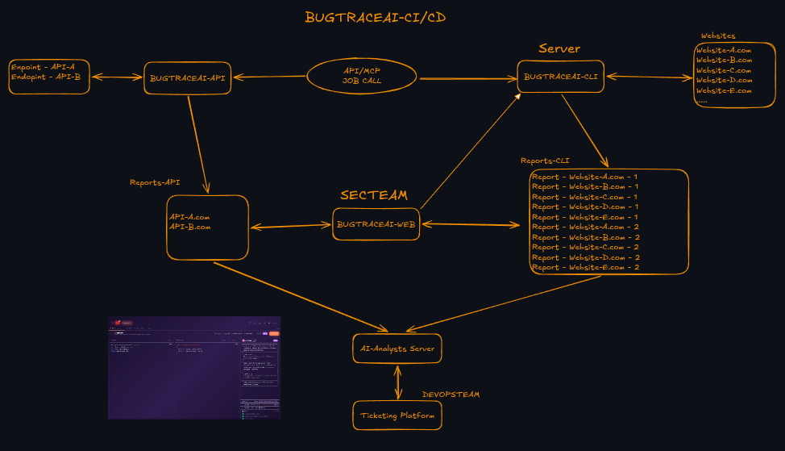

<p align="center">
  
</p>

<h1 align="center">BugTraceAI</h1>

<p align="center">
  <strong>Open-source, self-hosted web pentesting suite.</strong><br/>
  Agentic scanning, analyst tools, API testing and specialized security models.
</p>

BugTraceAI brings web and API testing engines, an analyst workspace, published model checkpoints and MCP integrations into one modular suite. Run the components you need on your own infrastructure and inspect the evidence behind each finding.

<p align="center">
  <a href="#quick-start">Install with Launcher</a> ·
  <a href="#documentation">Read the docs</a> ·
  <a href="https://demo.bugtraceai.com/bugtraceai">Explore a sample report</a> ·
  <a href="https://huggingface.co/BugTraceAI">Browse BugTraceAI models</a> ·
  <a href="https://discord.gg/5HjujkScC">Join the community</a>
</p>

<p align="center">
  <a href="https://www.youtube.com/watch?v=FCoQNgO8hmM">
    
  </a>
</p>

## Choose Your Workflow

| I want to… | Start with |
| --- | --- |
| Run an agentic web assessment in a terminal, or automate it through REST/MCP | [BugTraceAI-CLI](https://github.com/BugTraceAI/BugTraceAI-CLI) |
| Investigate HTTP traffic, use analyst tools, follow scans and review reports in a browser | [BugTraceAI-WEB](https://github.com/BugTraceAI/BugTraceAI-WEB) |
| Assess an API target with contract-aware discovery and evidence review | [BugTraceAI-API](https://github.com/BugTraceAI/BugTraceAI-API) |
| Select modules, configure services and install the suite | [BugTraceAI-Launcher](https://github.com/BugTraceAI/BugTraceAI-Launcher) |
| Explore the published BugTraceAI model checkpoints | [BugTraceAI Models](https://huggingface.co/BugTraceAI) |
| Connect additional security tools through MCP | [ReconFTW MCP](https://github.com/BugTraceAI/reconftw-mcp) |
| Practice against a deliberately vulnerable target | [BugStore](https://github.com/BugTraceAI/BugStore) |

WEB can connect to the CLI engine for web scans and the API engine for API-target scans. The Launcher lets you choose WEB, CLI, API or a combination.

## Jump To

- [Proven in the Security Community](#proven-in-the-security-community)
- [What is BugTraceAI?](#what-is-bugtraceai)
- [The Ecosystem](#the-ecosystem)
- [Models and ModelLab](#models-and-modellab)
- [Architecture](#architecture)
- [Scanning Pipeline](#scanning-pipeline)
- [Current Public Releases](#current-public-releases)
- [Demo Report](#demo-report)
- [CI/CD Integration Proposal](#cicd-integration-proposal)
- [Quick Start](#quick-start)
- [Documentation](#documentation)
- [Community & Support](#community--support)

---

## Proven in the Security Community

### CVEs Disclosed

| Product | CVE | CVSS |
| ------- | --- | ---- |
| Wallos | [CVE-2026-27479](https://www.cve.org/CVERecord?id=CVE-2026-27479) | 7.7 High |
| ZoneMinder | [CVE-2026-27470](https://www.cve.org/CVERecord?id=CVE-2026-27470) | 8.8 High |
| Piwigo | [CVE-2026-27834](https://www.cve.org/CVERecord?id=CVE-2026-27834) | 7.2 High |

### Presented On Stage

- [RootedCON 2026](https://reg.rootedcon.com/cfp/speaker/795), Madrid, Spain
- [HKOSCon 2026](https://hkoscon.org/2026/topic/bugtraceai-open-source-agentic-ai-for-autonomous-multi-agent-bug-bounty-pentesting/), Hong Kong
- [DEF CON 34](https://defcon.org/html/defcon-34/dc-34-speakers.html#content_66648), Las Vegas, USA

### See It Working

**CLI 4.0.16-beta · interactive terminal workspace**



The real TUI has five views: **Pipeline, Findings, Agents, Timeline and Logs**.
Configure the target, crawl limits, Provider/F7 and Auth/F8 from the workspace.
The terminal capture uses the built-in offline demo with sample data.
[Open the CLI screenshot gallery and installation guide](https://github.com/BugTraceAI/BugTraceAI-CLI#terminal-workspace).

<table>
  <tr>
    <td width="50%"><strong>WEB · API discovery</strong><br/></td>
    <td width="50%"><strong>WEB · specialist graph</strong><br/></td>
  </tr>
  <tr>
    <td width="50%"><strong>WEB · scan console</strong><br/></td>
    <td width="50%"><strong>WEB · report explorer</strong><br/></td>
  </tr>
</table>

WEB captures show the scan and reporting interfaces using the BugStore practice
target. Report counts in screenshots describe those example sessions.

BugTraceAI combines AI-guided investigation with deterministic security tools. The AI prioritizes and reasons about hypotheses; tools and evidence validate what is real.

## Disclaimer

This platform is provided for **educational and authorized security testing purposes only**.

- Only test applications for which you have **explicit, written authorization**
- AI output may contain inaccuracies, false positives, or false negatives
- It is **not** a substitute for professional security auditing
- The creators assume no liability for misuse or damage

**Always verify findings manually.**

---

## What is BugTraceAI?

**BugTraceAI** is an **open-source, self-hosted web pentesting suite** for authorized security research. It combines agentic scanning, an analyst workspace, an independent API-testing engine, published model checkpoints and extensible tools. Its scanning engines connect AI investigation with security checks, validation and reporting.

Its agents plan and prioritize checks, route work to specialists and collect evidence through the scanning tools and validation stages.

### Core Principles

| Principle         | Description                                                             |
| ----------------- | ----------------------------------------------------------------------- |
| **Privacy-First** | Self-hosted scanning and report storage; analysis uses your configured LLM provider |
| **Opensource**    | Apache-2.0 licensed public product repositories |
| **Self-Hosted**   | Scan reports and local services stay on your infrastructure                                  |
| **Modular**       | Use components independently or together                                |
| **Deployment**   | Local or Docker CLI profiles; full-platform setup through Launcher                                     |

---

## The Ecosystem

The suite includes **four independently deployable product components**, published model checkpoints, MCP integrations and a dedicated practice target:

<table>
  <tr>
    <th>Component</th>
    <th>Description</th>
    
    <th>Repository</th>
  </tr>
  <tr>
    <td><strong>BugTraceAI-API</strong></td>
    <td>Standalone evidence-first API security testing service over REST and MCP</td>
    
    <td><a href="https://github.com/BugTraceAI/BugTraceAI-API">BugTraceAI-API</a></td>
  </tr>
  <tr>
    <td><strong>BugTraceAI-CLI</strong></td>
    <td>Autonomous security scanner with a Textual terminal workspace, REST API and MCP. Multi-agent pipeline with specialist tools and browser validation</td>
    
    <td><a href="https://github.com/BugTraceAI/BugTraceAI-CLI">BugTraceAI-CLI</a></td>
  </tr>
  <tr>
    <td><strong>BugTraceAI-WEB</strong></td>
    <td>Web dashboard with 20+ AI security tools, real-time scan monitoring, and CLI control center</td>
    
    <td><a href="https://github.com/BugTraceAI/BugTraceAI-WEB">BugTraceAI-WEB</a></td>
  </tr>
  <tr>
    <td><strong>BugTraceAI-Launcher</strong></td>
    <td>Guided deployment with CLI TUI/API profiles, local or Docker runtime, optional global btai, service management and an optional <strong>AI Setup & Repair Assistant</strong></td>
    
    <td><a href="https://github.com/BugTraceAI/BugTraceAI-Launcher">BugTraceAI-Launcher</a></td>
  </tr>
  <tr>
    <td><strong>MCP Ecosystem</strong></td>
    <td>Extensible agent framework using the Model Context Protocol. Includes integrated Kali Linux and ReconFTW agents</td>
    
    <td><a href="https://github.com/BugTraceAI/reconftw-mcp">reconftw-mcp</a></td>
  </tr>
  <tr>
    <td><strong>BugStore</strong></td>
    <td>Deliberately vulnerable practice target used in demos and walkthroughs. Full-featured shop riddled with 32 planted OWASP vulnerabilities</td>
    
    <td><a href="https://github.com/BugTraceAI/BugStore">BugTraceAI/BugStore</a></td>
  </tr>
  <tr>
    <td><strong>BugTraceAI Models</strong></td>
    <td>Published model checkpoints for bug bounty and web pentesting workflows</td>
    
    <td><a href="https://huggingface.co/BugTraceAI">BugTraceAI Models</a></td>
  </tr>
</table>

Use the CLI TUI locally, its API/MCP for automation, or the Launcher to install independent products or a combination. The WEB connects to the appropriate scanning backend for each engine; API scans use BugTraceAI-API and web scans use the CLI API.

---

## Models and ModelLab

The suite's model ecosystem has three parts:

- **BugTraceAI Models:** published security-focused checkpoints for bug bounty and web pentesting workflows. See the [model catalog](https://huggingface.co/BugTraceAI) and individual model cards for requirements and usage.
- **External providers and models:** configurable options supported by each product component. Provider support and model roles vary by module; follow its current configuration guide.
- **ModelLab:** a benchmarking workspace in WEB for comparing selected OpenRouter models and reviewing their results and costs.

Publishing a checkpoint does not imply it is the default model in every component. Check each module's documentation for supported connections and configuration.

### Published model families

| Family | Focus | Model cards |
| --- | --- | --- |
| CORE-Fast | Rapid triage and scanner-output review | [CORE-Fast](https://huggingface.co/BugTraceAI/BugTraceAI-CORE-Fast) |
| CORE-Pro | Extended investigation, reporting and remediation support | [CORE-Pro](https://huggingface.co/BugTraceAI/BugTraceAI-CORE-Pro) |
| CORE-Ultra | Structured PoC generation and tool-calling workflows | [Q4](https://huggingface.co/BugTraceAI/BugTraceAI-CORE-Ultra-27B-Q4) · [Q6](https://huggingface.co/BugTraceAI/BugTraceAI-CORE-Ultra-27B-Q6) |
| Apex | Offensive security reasoning | [Q4](https://huggingface.co/BugTraceAI/BugTraceAI-Apex-G4-26B-Q4) · [F16](https://huggingface.co/BugTraceAI/BugTraceAI-Apex-G4-26B-Master-f16) |

Consult each model card for serving requirements, formats, license terms and intended use.

### Providers by workflow

| Workflow | Provider support described by the current public product documentation |
| --- | --- |
| CLI web scans | OpenRouter, Anthropic and Z.ai presets; Amazon Bedrock in beta; custom/local OpenAI-compatible presets. See the [CLI configuration guide](https://github.com/BugTraceAI/BugTraceAI-CLI#configuration-and-reports) and [Bedrock guide](https://github.com/BugTraceAI/BugTraceAI-CLI/blob/main/BEDROCK.md). |
| API-target investigation and AI review | OpenRouter, Anthropic, Z.ai and local Ollama; AI enrichment is optional. See [API providers](https://github.com/BugTraceAI/BugTraceAI-API#ai-providers). |
| WEB analysis tools, chat and AIrepeater | OpenRouter, Anthropic and Z.ai. The provider configured for a connected CLI scan is a separate setting. See [WEB setup](https://github.com/BugTraceAI/BugTraceAI-WEB#configure-your-workspace). |
| WEB ModelLab | OpenRouter with the module's own key. See [WEB workspace](https://github.com/BugTraceAI/BugTraceAI-WEB#workspace). |
| Launcher AI setup and repair | OpenRouter or Anthropic. Wizard supports Z.ai setup. See the [Launcher guide](https://github.com/BugTraceAI/BugTraceAI-Launcher#readme). |

Model support depends on the selected component, provider, task and configuration. Bedrock remains beta with real AWS account validation pending, as stated in its release notes.

---

## Architecture



The CLI stores scan metadata in SQLite and writes report artifacts to disk.
The WEB uses PostgreSQL for its own chats, settings and analysis. The Launcher
configures service connections and selected ports. Standalone local TUI setup
opens the engine without starting an API server.

See the [component documentation](#documentation) for deployment details.

---

## Scanning Pipeline

The CLI terminal and WEB display the same six scan phases:

| Phase | Purpose |
| --- | --- |
| **Recon** | Crawl the target and discover endpoints |
| **Discovery** | Analyze URLs and collect initial findings |
| **Strategy** | Consolidate findings and route work to specialists |
| **Exploit** | Run specialist checks and collect evidence |
| **Validate** | Verify findings through the validation stage |
| **Report** | Generate structured and human-readable deliverables |

Target authentication supports Bearer tokens and login YAML with optional
TOTP/2FA. In the TUI, configure it through **Auth/F8**, separately from the
LLM provider's API key in **Provider/F7**. See the
[CLI installation guide](https://github.com/BugTraceAI/BugTraceAI-CLI/blob/main/INSTALLATION.md).

## Current Public Releases

| Component | Version | Highlights |
| --- | --- | --- |
| [CLI](https://github.com/BugTraceAI/BugTraceAI-CLI/releases/tag/v4.0.34-beta) | **4.0.34-beta** | Terminal TUI, web-scanning API/MCP, provider/auth setup and optional global `btai` |
| [WEB](https://github.com/BugTraceAI/BugTraceAI-WEB/releases/tag/v2.0.37-beta) | **2.0.37-beta** | Browser workspace for both scanning engines and reports |
| [API](https://github.com/BugTraceAI/BugTraceAI-API/releases/tag/v1.4.11-beta) | **1.4.11-beta** | Independent API-target engine with REST and MCP |
| [Launcher](https://github.com/BugTraceAI/BugTraceAI-Launcher/releases/tag/v3.3.34) | **3.3.34** | Universal TUI installer, independent module selection and Wizard or AI setup |

These releases include the Bedrock beta CLI provider and WEB region controls,
model-override and scan safe-mode fixes, and tolerant Launcher output decoding.
The source and curated release copies passed offline checks. Real AWS account
validation remains pending; see the [Bedrock guide](https://github.com/BugTraceAI/BugTraceAI-CLI/blob/main/BEDROCK.md).
A fresh full installation, macOS and ARM were not validated in this release review.

## Demo Report

Want to see what BugTraceAI produces? Try the **live demo** or download a real scan report generated against [BugStore](https://bugstore.bugtraceai.com/) -- our deliberately vulnerable practice app.

<p align="center">
  <a href="https://demo.bugtraceai.com/bugtraceai">
    
  </a>
  &nbsp;
  <a href="https://github.com/BugTraceAI/BugTraceAI/releases/download/demo-report/BugTraceAI-Demo-Report.zip">
    
  </a>
</p>

> **Benchmark note:** This demo report was produced with an earlier scanner build. Results are useful for exploring the workflow, but should not be treated as a current performance claim for the latest CLI release until re-run under a versioned benchmark protocol.

The zip includes the full markdown report, validated findings JSON, specialist agent results with WET/DRY traceability, reconnaissance data, and PoC enrichment output.

---

## CI/CD Integration Proposal

For CI/CD, automation can call the **CLI REST/MCP interfaces** for web scans or **BugTraceAI-API** for API-target testing. Reports and evidence are available for review in the WEB workspace. The diagram below proposes downstream AI review and ticketing integrations; connect them to the selected engine's supported interfaces.

<p align="center">
  
</p>

This keeps external automation, autonomous scanning, evidence-rich reporting, human review, and remediation coordination connected without hard-coding deployment-specific service endpoints.

---

## Quick Start

### Choose your setup

- **Terminal workspace:** Linux and Python 3.10+ for local installation;
  some specialist tools also use Docker when scanning.
- **API/MCP or full WEB platform:** select the relevant profile and runtime in
  the installer. Docker deployments need Docker Engine, Compose and Git.
- **Real scans:** configure a supported provider's API key. Opening the TUI or
  its offline demo does not require starting a scan.

### One-Command Install

**One-liner** (recommended):

```bash
curl -fsSL https://raw.githubusercontent.com/BugTraceAI/BugTraceAI-Launcher/main/install.sh | bash
```

Or clone and run manually:

```bash
git clone https://github.com/BugTraceAI/BugTraceAI-Launcher.git ~/bugtraceai-launcher
~/bugtraceai-launcher/launcher.sh
```

From this ecosystem checkout, `./install.sh` opens the same universal menu
with `full` suggested. Component `./install.sh` entry points suggest their
own product in that menu; they do not deploy a profile without your review.

Enter and verify a provider API key on the first screen, then choose
**Install with Wizard** or **Install with AI**. Both stay in the TUI. Wizard
supports every module combination. AI setup uses OpenRouter or Anthropic provider tokens; use Wizard for Z.ai.
See the [current Launcher guide](https://github.com/BugTraceAI/BugTraceAI-Launcher#readme)
for supported module combinations and installation options.
The review shows selected modules, runtime, ports and optional WEB toolboxes.
Terminal profiles can register a global `btai` command.

### Let your AI coding agent run setup

If you use Codex, Claude Code, Cursor or another local terminal agent, give it
this prompt:

```text
Help me install BugTraceAI using the official universal Launcher.

First read:
https://github.com/BugTraceAI/BugTraceAI#readme
https://github.com/BugTraceAI/BugTraceAI-Launcher#readme

Follow those instructions using the official installer:
https://raw.githubusercontent.com/BugTraceAI/BugTraceAI-Launcher/main/install.sh

Ask which independent modules I want: BugTraceAI-WEB, BugTraceAI-CLI,
BugTraceAI-API, or a combination. Install only the modules I choose. Let me
choose Wizard or the built-in AI installer when my selection is supported;
use Wizard for other combinations.

Preserve any existing installation, configuration and data. Run the
Launcher in my local interactive terminal. I will enter and verify the
provider API key there, choose ports and review the plan before installation.
Keep credentials out of chat and logs. Do not start a scan.

Verify the selected services on their configured ports. If I enable the
global btai command, check it from a fresh shell. Report the installation
location, launch commands, checks completed and any checks still pending.
```

| Profile | Installed products | Runtime |
| --- | --- | --- |
| `terminal` | CLI terminal TUI | Local Python or Docker |
| `web` | WEB is preselected; add either or both scanning engines if needed | Docker |
| `full` | WEB + both scanning engines + CLI terminal TUI | Docker |
| `server` | CLI web-scanning API/MCP | Local Python or Docker |
| `terminal-server` | CLI TUI + web-scanning API/MCP, without WEB | Local Python or Docker |
| `api` | Independent BugTraceAI-API target engine, REST + MCP | Docker |

For direct component installation, use each checkout's explicit
`scripts/install-runtime.sh` backend or the documented Python/Compose commands. Follow
[INSTALLATION.md](INSTALLATION.md); a bare WEB `docker compose up` is not a
complete configuration step.

Component entry points suggest their own module. A suggestion only sets the
initial checkboxes; review the exact modules before installation.

---

## Documentation

Full documentation is available in the **[Project Wiki](https://github.com/BugTraceAI/BugTraceAI/wiki)**:

- [Overview](https://github.com/BugTraceAI/BugTraceAI/wiki/Overview) -- What BugTraceAI is and who it's for
- [Architecture](https://github.com/BugTraceAI/BugTraceAI/wiki/Architecture) -- System design and communication protocols
- [BugTraceAI-CLI](https://github.com/BugTraceAI/BugTraceAI/wiki/BugTraceAI-CLI) -- Autonomous scanner documentation
- [BugTraceAI-WEB](https://github.com/BugTraceAI/BugTraceAI/wiki/BugTraceAI-WEB) -- Web dashboard documentation
- [BugTraceAI-API](https://github.com/BugTraceAI/BugTraceAI-API#readme) -- REST/MCP API-security service, evidence artifacts, and deployment guidance
- [BugTraceAI-API on DeepWiki](https://deepwiki.com/BugTraceAI/BugTraceAI-API) -- AI-powered codebase documentation and architecture exploration
- [BugTraceAI-Launcher](https://github.com/BugTraceAI/BugTraceAI/wiki/BugTraceAI-Launcher) -- Deployment guide
- [CLI API Reference](https://github.com/BugTraceAI/BugTraceAI/wiki/API-Reference) -- CLI REST API and WebSocket endpoints
- [Getting Started](https://github.com/BugTraceAI/BugTraceAI/wiki/Getting-Started) -- Installation and first scan

---

## Community & Support

| Resource | Link                                                             |
| -------- | ---------------------------------------------------------------- |
| Website  | [bugtraceai.com](https://bugtraceai.com)                         |
| Wiki     | [GitHub Wiki](https://github.com/BugTraceAI/BugTraceAI/wiki)     |
| DeepWiki | [AI-powered docs](https://deepwiki.com/BugTraceAI/BugTraceAI)    |
| Issues   | [GitHub Issues](https://github.com/BugTraceAI/BugTraceAI/issues) |
| Discord  | [Join the BugTraceAI community](https://discord.gg/5HjujkScC)    |
| Twitter  | [@yz9yt](https://x.com/yz9yt)                                    |

### Contributing

We welcome contributions: bug reports, feature requests, PRs, documentation improvements, and community tools. Open an issue on the respective repository to get started.

---

## License

**Apache License 2.0** — BugTraceAI-owned material is free to use, modify, and distribute under the terms of the Apache License, Version 2.0.

See LICENSE file in each repository.

---

<p align="center">
  <strong>BugTraceAI</strong> -- Build your own self-hosted pentesting platform.<br/>
  If BugTraceAI helps your authorized security research, consider <a href="https://github.com/BugTraceAI/BugTraceAI/stargazers">giving the project a star</a> or <a href="https://discord.gg/5HjujkScC">joining the community on Discord</a>.<br/>
  <a href="https://github.com/yz9yt">Albert C (@yz9yt)</a>
</p>
